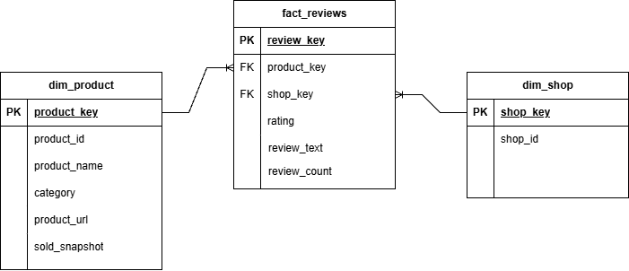

# Tokopedia ETL Pipeline

## 1. Deskripsi Proyek

Proyek ini bertujuan membangun ETL (Extract, Transform, Load) Pipeline menggunakan dataset ulasan produk Tokopedia tahun 2019.

Pipeline dibuat menggunakan Python untuk mengekstrak data dari file CSV, melakukan pembersihan dan transformasi data, kemudian memuat data yang telah diproses ke PostgreSQL.

Selanjutnya, pipeline secara otomatis membangun struktur Star Schema yang terdiri dari tabel dimensi (dimension table) dan tabel fakta (fact table) untuk mendukung analisis bisnis menggunakan SQL.

## 2. Tujuan Proyek

- Membangun ETL Pipeline menggunakan Python.
- Melakukan pembersihan dan transformasi data.
- Mengelola dan menyimpan data menggunakan PostgreSQL.
- Merancang dan membangun struktur Star Schema.
- Melakukan analisis bisnis berdasarkan data produk dan ulasan.

## 3. Teknologi yang Digunakan

- Python
- Pandas
- PostgreSQL
- SQLAlchemy
- SQL
- Visual Studio Code
- pgAdmin 4

## 4. Dataset

**Sumber Dataset:** [Tokopedia Product and Review Dataset 2019](https://huggingface.co/datasets/farhamu/tokopedia-product-reviews-2019)

Dataset berisi 40.607 baris dan 8 kolom yang mencakup informasi:

- Ulasan pelanggan
- Rating produk
- Kategori produk
- Nama produk
- ID produk
- Jumlah produk terjual
- ID toko
- URL produk

## 5. Alur ETL Pipeline

### Extract
Mengambil data mentah dari file CSV menggunakan Pandas.

### Transform
Melakukan pembersihan dan transformasi data, meliputi:
- Membersihkan spasi berlebih pada kolom teks.
- Mengonversi nilai jumlah produk terjual ke format numerik.
- Menangani nilai kosong dan data yang tidak dapat dikonversi.
- Memvalidasi rating dan duplikasi data.

### Load
Memuat data hasil transformasi ke PostgreSQL pada tabel staging `clean_tokopedia_reviews`.

### Build Star Schema
Membangun tabel dimensi dan fakta secara otomatis menggunakan Python dan SQLAlchemy.

## 6. Perancangan Star Schema

Star Schema terdiri dari tiga tabel utama:

### Dimension Tables

**dim_product**
- product_key
- product_id
- product_name
- category
- product_url
- sold

**dim_shop**
- shop_key
- shop_id

### Fact Table

**fact_reviews**
- review_key
- product_key
- shop_key
- rating
- review_text
- review_count

Tabel fakta terhubung dengan tabel dimensi melalui foreign key.

## 7. Star Schema Design

Berikut merupakan rancangan dimensional model yang digunakan dalam proyek ETL ini.

## 8. Hasil Data Cleaning

| Indikator | Hasil |
|---|---:|
| Total baris data | 40.607 |
| Total kolom | 8 |
| Missing value awal pada sold | 14 |
| Missing value sold setelah transformasi | 67 |
| Duplikasi data | 0 |
| Rating tidak valid | 0 |

## 9. Hasil Pembangunan Data Warehouse

| Tabel | Jumlah Baris |
|---|---:|
| clean_tokopedia_reviews | 40.607 |
| dim_product | 3.664 |
| dim_shop | 158 |
| fact_reviews | 40.607 |

Seluruh data pada tabel fakta berhasil terhubung dengan tabel dimensi produk dan toko.

## 10. Analisis Bisnis

Analisis bisnis dilakukan menggunakan SQL berdasarkan struktur Star Schema.

Analisis yang dilakukan meliputi:

1. 10 produk dengan rating tertinggi.
2. Perbandingan rating produk berdasarkan kategori.
3. 10 produk dengan jumlah terjual tertinggi.
4. Total jumlah produk terjual berdasarkan kategori.

Query analisis tersedia pada folder `sql/analysis_queries.sql`.
